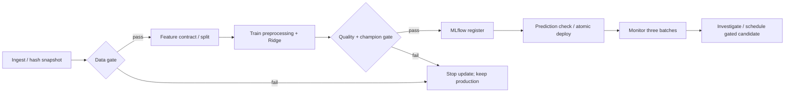

# Group 4 · House-price MLOps capstone

**AI handoff:** Read [CLAUDE.md](CLAUDE.md) for current state and continuation instructions.

**New reader: start with [START_HERE_PROJECT_HANDOFF.md](START_HERE_PROJECT_HANDOFF.md).** It explains what was requested, what is verified, which files are ready, and exactly what remains on your side.

**Raw listings → validated model → monitored serving, with safe failure.**

Swagata Bhowmik (B053) · Sumit Kothari (B062)  
Project 4, Elective II: MLOps · Dr. Santosh Kumar

## Measured outcome

| Evidence | Result |
|---|---|
| Initial Ridge validation | MAE **₹5.742 lakhs**, RMSE ₹7.522 lakhs |
| Reserved historical test, 800 listings | MAE **₹5.775 lakhs**, RMSE ₹7.506 lakhs |
| Incoming batch 1 | MAE ₹5.562 lakhs; no configured drift/performance alert |
| Incoming batch 2 | MAE ₹6.867 lakhs; area-distribution alert |
| Incoming batch 3 | MAE ₹13.113 lakhs; area, bedrooms, bathrooms, city-zone and performance alerts |
| Bad-data and bad-model demonstrations | Both rejected; previous model version and prediction preserved |
| Model rollback | Executed and verified through the API |

Read [the monitoring report](reports/monitoring.html), [full project context](PROJECT_CONTEXT.md), [design note](output/pdf/design_note.pdf), and [submission checklist](docs/SUBMISSION.md).

**Current status (22 October 2026):** GitHub tests/container checks, Docker Hub releases, the public Render API, and automatic main-branch deployment are verified. Open [the live dashboard](https://group4-mlflow-capstone.onrender.com/) or [the API docs](https://group4-mlflow-capstone.onrender.com/docs). GitHub Actions deploys the exact passing commit and verifies live lineage. Render's native auto-deploy setting is intentionally off.

**Evidence boundary:** Full persistent MLflow/Prometheus/Grafana hosting, live rollback/failure demonstrations, workload measurements, PR scenario evidence, screenshots, and final presentation remain pending. Render Free sleeps when idle and restores image-baked model state on restart. See [the current checklist](docs/SUBMISSION.md).

## Historical Windows instructions

The active workstation is macOS. These Windows instructions are optional reference.

Read [WINDOWS_START_HERE.md](WINDOWS_START_HERE.md) for the complete inventory, Docker-first PowerShell instructions and remaining submission checklist. Do not run the POSIX pipeline directly with native Windows Python.

## Start locally

Use Python 3.12. From the project root, on a computer with package-download access:

```sh
python3 -m venv .venv
source .venv/bin/activate
pip install -r requirements.lock
python -m pytest -q
python -m capstone run
python -m capstone serve
```

In the current workspace `.venv` already contains MLflow and uses preinstalled scientific packages. `requirements.lock` records the dependency closure; a clean environment/container install is prepared but has not been executed here.

The dashboard is at `http://localhost:8000/` and the API docs at `http://localhost:8000/docs`. The dashboard reads only the API: `/schema`, `/pipeline`, `/monitoring`, `/samples` and `/stats` are read-only views of the serving run, and predictions use `POST /predict`; `/health`, `/lineage`, and `/metrics` expose serving status, provenance, and Prometheus metrics. No credentials are needed for this local-only demonstration. Do not expose these development services publicly without authentication.

Example request:

```sh
curl -X POST http://localhost:8000/predict \
  -H 'Content-Type: application/json' \
  -d '{"records":[{"Area_sqft":1200,"Bedrooms":2,"Bathrooms":2,"Age_Years":10,"Distance_to_Center_km":8,"Neighborhood_Score":7,"Has_Parking":1,"Property_Condition":"Good","City_Zone":"Central"}]}'
```

Price outputs use **₹ lakhs**. The API rejects invalid or extra fields with HTTP 422. Only the three nullable numeric fields may be null. Each request supports up to the configured batch size.

## Workflow and commands



The runner is a small persisted DAG implemented in `capstone/core.py`: explicit dependencies, artifact hashes, stage outputs, execution times, failure records, and MLflow run history. It substitutes for Prefect/ZenML under the brief's allowance for justified equivalents. It is designed for one local worker; it does not claim distributed scheduling or automatic retries. NumPy/SciPy/pandas monitoring replaces Evidently with transparent effect-size measures. Git-tracked CSVs plus SHA-256 manifests and immutable run snapshots replace DVC for this 285 KB dataset; Git setup remains pending.

```sh
# Full pipeline; prints RUN_DIRECTORY for later reruns
python -m capstone run
# Lightweight execution without production promotion
python -m capstone run --stop-after evaluate
# Rerun one stage using its persisted prerequisites; no full-pipeline rerun
python -m capstone stage evaluate --run state/runs/ACTUAL_RUN_ID
# Batch monitoring / source lineage / model rollback
python -m capstone monitor
python -m capstone lineage
python -m capstone rollback
# Safe failure, second release, rollback, API metrics and lineage evidence
python -m capstone demo
# One-time final test; refuses if a result already exists
python -m capstone final-test
# Actual registry/run evidence export
PYTHONPATH=. python scripts/snapshot_registry.py
```

A rerun invalidates downstream stage status. Upstream artifact changes are rejected. Deployed runs are immutable; only monitoring may be rerun. Use a new run to change the model. Failed runs remain available in `state/runs/` and MLflow.

## Configuration and thresholds

`config.yaml` is the production workflow's single configuration. Pydantic checks unknown keys, feature leakage, ranges, split fractions, and gate limits. `experiments/baseline_config.yaml` is the preserved, earlier exploratory comparison, not a second production configuration.

- Data gate: correct schema, unique IDs, plausible ranges, integer constraints, known categories, at least 100 rows and ≤8% missing per column. The supplied data has 4% missingness in three columns.
- Model gate: validation MAE ≤₹7 lakhs, RMSE ≤₹9 lakhs, and MAE no more than 2% worse than the incumbent on the same validation records. The first release uses absolute gates only.
- Monitoring: KS D >0.10 on numeric features, total variation >0.10 on categories, missing-rate change >3 percentage points. These are practical effect-size thresholds, not statistical significance declarations.
- Performance alert: batch MAE >₹7 lakhs **or** >1.25× deployed validation MAE. Batch labels are used only for monitoring, not initial training or model selection.
- Operational objectives: warm p95 ≤200 ms; request error fraction ≤1%; investigate models older than 30 days. Local TestClient timings are not network/load-test capacity claims.

Thresholds are project design decisions, informed by initial data/model exploration, not professor-supplied business SLAs. The 800-row final test is never used by the promotion gate. Incoming batches were explored before thresholds were finalized; they are a demonstration, not a blind prospective drift test.

After configuration edits, regenerate monitoring files with `PYTHONPATH=. python scripts/generate_monitoring_config.py`. Generated YAML/JSON are deployment artifacts.

## MLflow and lineage

`state/mlflow.db` contains actual experiments and registered models; artifact files are in `state/mlartifacts/`. On an unrestricted local machine:

```sh
mlflow server --backend-store-uri sqlite:///state/mlflow.db --host 127.0.0.1 --port 5000
```

Open `http://localhost:5000`. Registry transitions use `validated`, `production`, and `archived` lifecycle tags plus a `champion` alias. This replaces deprecated stages in current MLflow ([official workflow documentation](https://www.mlflow.org/docs/latest/ml/model-registry/workflow/)). Only pipeline deployment/rollback functions change these labels in this project.

The serving manifest is the source of truth for loading the model. A filesystem lock serializes promotions and rollback. Model bytes are copied into a release directory, checked, and switched using atomic rename. The API loads a changed artifact before replacing its in-memory model. It retains a cached healthy model if a replacement cannot load. Registry labels and the serving pointer cannot share a single database transaction; a process crash between their writes requires comparing `/lineage` with the alias and repairing it through deployment operations. This is a documented local-demo limitation.

Lineage contains source-file hashes and archived source, data SHA-256, full configuration, run ID, model hash, and registry version. Local commits are explicitly labeled `uncommitted-local-source`; CI injects the real `GITHUB_SHA`. Run snapshots contain machine-local absolute paths; regenerate runs after relocating the project or moving into Docker.

## Docker and monitoring

Install/start a Docker runtime on your own computer before these commands. The Python `docker` package installed with MLflow is **not** a container runtime.

```sh
PYTHONPATH=. python scripts/generate_monitoring_config.py
docker compose build
docker compose --profile jobs run --rm pipeline
docker compose up -d api mlflow prometheus grafana
```

Ports, bound only to localhost: API 8000, MLflow 5000, Prometheus 9090, Grafana 3000. Grafana includes latency, throughput, errors, prediction distribution, mean price, and model age. The API mounts model state read-only. Training and registry operations have write access. Prometheus alert rules are provided; outbound alert delivery is not configured.

The pipeline container writes fresh reports to the named `report-data` volume. To inspect them, use `docker compose --profile jobs run --rm pipeline cat reports/monitoring.json`. The existing local `reports/monitoring.html` provides the measured local batch report without requiring Grafana. `reports/operational.json` states the measurement method and timing. `reports/prometheus_metrics.txt` is a real captured API metrics response.

## CI/CD and release

`.github/workflows/ci.yml` runs tests and a lightweight pipeline on PRs. `release.yml` checks tests and a container smoke run, builds/pushes a commit-tagged Docker Hub image on `main`, and creates a GitHub release. Configure GitHub variables `DOCKERHUB_USERNAME` and optionally `DOCKERHUB_REPOSITORY` (default `group4-mlflow-capstone`), plus secret `DOCKERHUB_TOKEN`. See [Docker Hub setup and server deployment](docs/DOCKER_HUB_DEPLOYMENT.md). The release records an exact image digest and automatic deployment uses it. The workflow currently targets `linux/amd64`. Persistent deployment needs an authenticated Docker host: register it as a self-hosted runner with label `capstone`, then set repository variable `ENABLE_LOCAL_DEPLOY=true`. Until then the workflow publishes a deployable release but does not update a persistent endpoint.

`scripts/deploy.sh` runs model gates before changing the serving container and attempts model/image rollback if health checks fail. This container rollout is unexecuted here and may briefly interrupt connections while Compose replaces the API; safe rejection of bad data/models leaves the existing container intact.

For document regeneration only, install ReportLab (`pip install reportlab`) and run `python scripts/build_documents.py`; the delivered PDFs are already rendered and inspected. PDF generation is separate from the runtime dependency lock.

Read [rollback and recovery](docs/OPERATIONS.md), [demo script](docs/DEMO.md), and [remaining evidence checklist](docs/SUBMISSION.md). Both students must make real contributions and be able to explain and modify the code; do not fabricate commits or CI screenshots.
