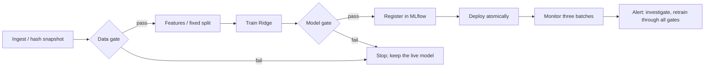

# Group 4 · House-price MLOps capstone

**Raw listings → validated model → monitored serving, with safe failure.**

Swagata Bhowmik (B053) · Sumit Kothari (B062)
Project 4, Elective II: MLOps · Dr. Santosh Kumar

**Live:** [dashboard](https://group4-mlflow-capstone.onrender.com/) · [API docs](https://group4-mlflow-capstone.onrender.com/docs) · [lineage](https://group4-mlflow-capstone.onrender.com/lineage) (free host: the first request after idle can take about a minute)

**Documents:** [design note](output/pdf/design_note.pdf) · [reflection](output/pdf/reflection.pdf) · [presentation](output/pdf/presentation.pdf) · [screenshots](output/screenshots/README.md) · [demo script](docs/DEMO.md) · [operations and rollback](docs/OPERATIONS.md) · [submission checklist](docs/SUBMISSION.md)

## Results

| Evidence | Result |
|---|---|
| Ridge (alpha 10) validation | MAE **₹5.74 lakhs**, RMSE ₹7.52 lakhs |
| Reserved test set, 800 listings | MAE **₹5.78 lakhs**, RMSE ₹7.51 lakhs |
| Incoming batch 1 | MAE ₹5.56 lakhs; no alert |
| Incoming batch 2 | MAE ₹6.87 lakhs; area drift |
| Incoming batch 3 | MAE ₹13.11 lakhs; area, bedrooms, bathrooms and city-zone drift; performance alert |
| Failing gates on a real server | Bad data stopped at validate, bad model at evaluate; 0 errors while serving ([live_safe_failures.json](reports/live_safe_failures.json)) |
| CI | PR #2 (alpha 1000) failed at the model gate and was fixed; every merge to `main` is released and deployed |
| Live rollback | Rolled back to an earlier release and forward again, verified via `/lineage` ([render_rollback.json](reports/render_rollback.json)) |
| Load test | 300 requests to the live service, 0 errors; p95 above 200 ms with 5 concurrent clients on the free host ([load_test.json](reports/load_test.json)) |
| Fresh-clone reproduction | Clean install, all tests pass, validation MAE reproduced ([fresh_clone_reproduction.json](reports/fresh_clone_reproduction.json)) |

## Run it locally

Python 3.12. **Windows:** follow [docs/WINDOWS_SETUP.md](docs/WINDOWS_SETUP.md). **macOS / Linux:**

```sh
python3.12 -m venv .venv
source .venv/bin/activate
pip install -r requirements.lock
python -m pytest -q          # 16 tests
python -m capstone run       # all 8 stages
python -m capstone serve     # dashboard at http://localhost:8000/
```

MLflow UI: `mlflow ui --backend-store-uri sqlite:///state/mlflow.db --port 5000`, then open http://localhost:5000.

Example prediction (prices are in ₹ lakhs; invalid or extra fields return HTTP 422):

```sh
curl -X POST http://localhost:8000/predict -H 'Content-Type: application/json' \
  -d '{"records":[{"Area_sqft":1200,"Bedrooms":2,"Bathrooms":2,"Age_Years":10,"Distance_to_Center_km":8,"Neighborhood_Score":7,"Has_Parking":1,"Property_Condition":"Good","City_Zone":"Central"}]}'
```

## Pipeline



`capstone/core.py` runs the stages as a small persisted DAG: explicit dependencies, artifact hashes,
per-stage logs and timings, failure records, and an MLflow run for every execution. It stands in for
Prefect/ZenML; monitoring uses SciPy effect sizes instead of Evidently; Git plus SHA-256 snapshots
replace DVC for the small supplied CSVs. The brief allows justified free substitutes.

```sh
python -m capstone run --stop-after evaluate            # lightweight run, no promotion
python -m capstone stage evaluate --run state/runs/ID   # re-run one stage
python -m capstone monitor                              # three-batch drift and error report
python -m capstone lineage                              # lineage of the deployed model
python -m capstone rollback                             # restore the previous model
python scripts/live_safe_failure.py                     # failing gates against a live server
python scripts/load_test.py                             # network workload against the live service
```

Re-running a stage invalidates its descendants; a changed upstream artifact is refused; deployed runs
are immutable. Failed runs stay in `state/runs/` and MLflow.

## Configuration and gates

`config.yaml` is the single source of truth; `capstone/config.py` validates it on load (unknown keys,
feature leakage, ranges, split fractions, limits).

- **Data gate:** exact schema, unique IDs, known categories, numeric ranges and integer types, at least 100 rows, at most 8% missing per column.
- **Model gate:** validation MAE ≤ ₹7 lakhs, RMSE ≤ ₹9 lakhs, and at most 2% worse than the deployed model.
- **Monitoring:** numeric KS D > 0.10, categorical total variation > 0.10, missing-rate change > 3 points; performance alert when MAE > ₹7 lakhs or > 1.25 × validation MAE.
- **Service:** p95 latency ≤ 200 ms, error rate ≤ 1%, review models older than 30 days.

The reserved test set is reported once and never used for model selection.

## Tracking, registry and lineage

Every run records configuration, code hash, Git commit, data hash, stage results and metrics in
MLflow. Registered versions carry `validated` / `production` / `archived` tags and a `champion` alias;
only the deploy and rollback functions change them. `/lineage` on the live service and the dashboard's
Lineage tab trace the serving model to its commit, MLflow run, data hash and configuration.

## CI/CD and deployment

- `.github/workflows/ci.yml` — on every pull request, on Ubuntu and Windows: tests plus the pipeline up to the model gate.
- `.github/workflows/release.yml` — on `main`: tests, container smoke test, Docker Hub image tagged with the commit, GitHub release `build-<sha>`, then deployment of that exact commit to Render (verified through live `/lineage`).
- `.github/workflows/rollback.yml` — manual: redeploys an earlier released commit; see [OPERATIONS.md](docs/OPERATIONS.md).

The full monitoring stack (API, MLflow, Prometheus, Grafana) is defined in `compose.yaml` for a Docker host:

```sh
python scripts/generate_monitoring_config.py
docker compose build && docker compose --profile jobs run --rm pipeline
docker compose up -d api mlflow prometheus grafana   # ports 8000, 5000, 9090, 3000 on localhost
```

## Limits

Render Free runs one worker with no persistent state or authentication, so the incumbent comparison
across releases is shown locally rather than on Render. The latency target is not met under concurrent
load on the free host. Prometheus and Grafana run only on a Docker host.
