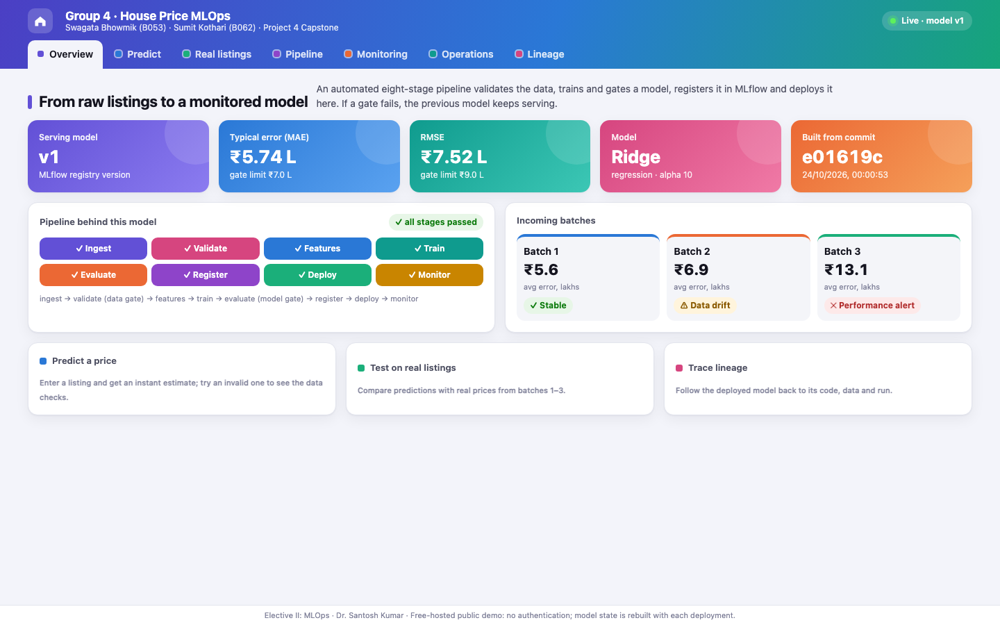
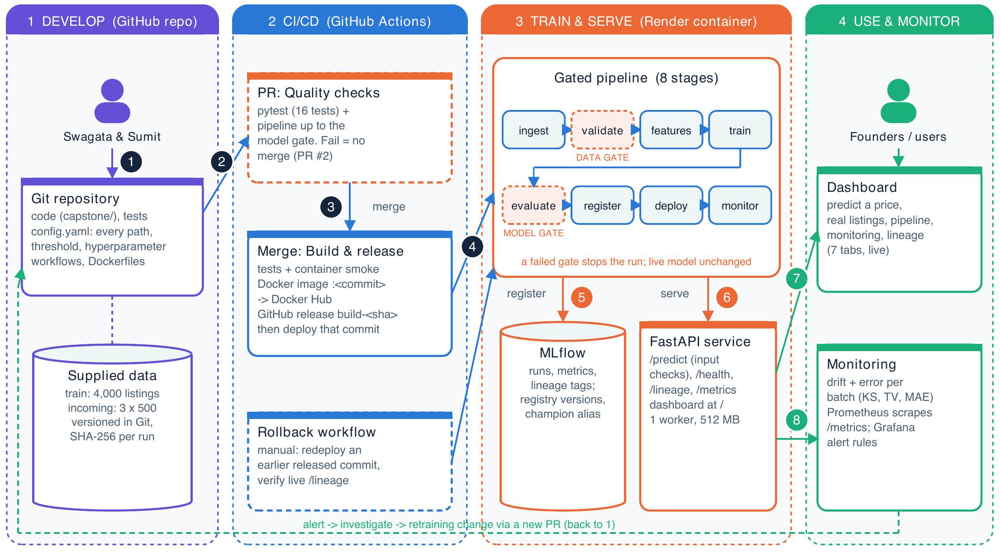
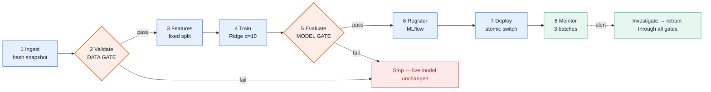
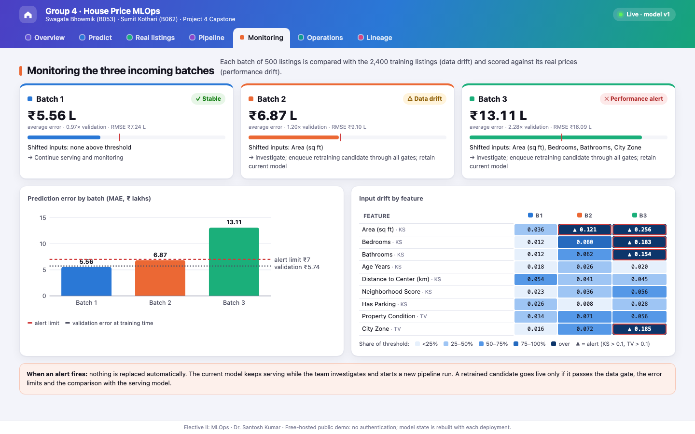
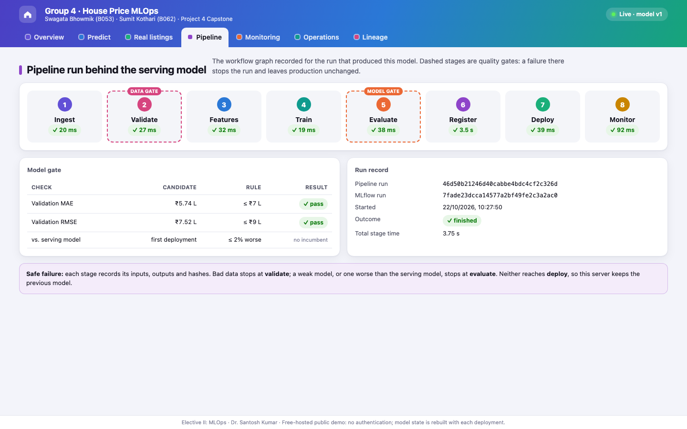
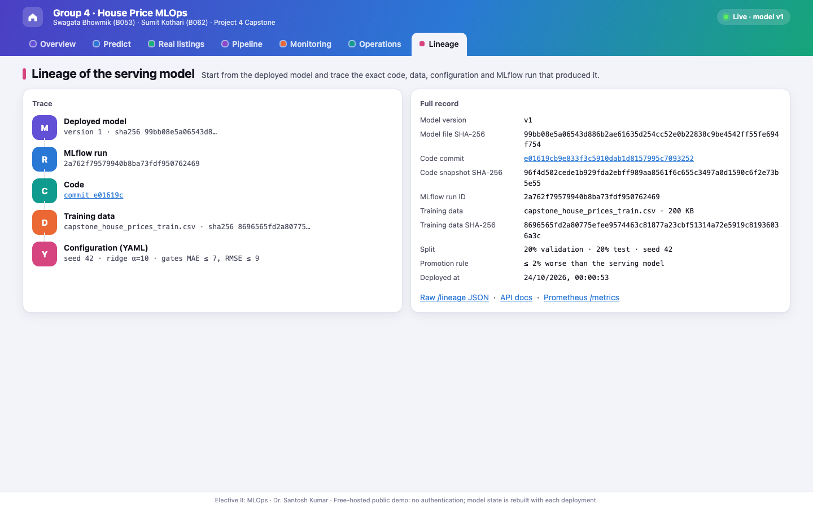

<div align="center">

# 🏠 From Raw Listings to a Monitored Model

### An end-to-end MLflow pipeline that predicts house prices — and refuses to ship bad data or bad models

**Group 4 · Swagata Bhowmik (B053) · Sumit Kothari (B062)**<br>
Project 4 Capstone · Elective II: MLOps · Dr. Santosh Kumar

<br>

[](https://group4-mlflow-capstone.onrender.com/)
[](https://group4-mlflow-capstone.onrender.com/docs)
[](https://group4-mlflow-capstone.onrender.com/lineage)
[](output/pdf/presentation.pdf)

[](https://github.com/Swagata-Bhowmik/group4-mlflow-capstone/actions/workflows/release.yml)


<br>



</div>

---

## ⚡ At a glance

<div align="center">

| 🎯 Average error | 🧪 Held-out test | ⚙️ Pipeline | 🛡️ Safety gates | 📦 Batches monitored | 🚀 Live load test |
|:---:|:---:|:---:|:---:|:---:|:---:|
| **± ₹5.74 lakh** | **₹5.78 lakh** | **8 stages** | **2 gates** | **3 × 500** | **300 requests · 0 errors** |
| about 9% of a typical listing | never used for tuning | each re-runnable | data + model | drift + error | on the free host |

</div>

---

## 🧭 Where to look

| I want to… | Go here |
|---|---|
| **Try the model right now** | [Live dashboard](https://group4-mlflow-capstone.onrender.com/) → *Predict* tab |
| See the **pipeline code** | [`capstone/core.py`](capstone/core.py) — the 8 stages, gates, promotion, rollback |
| See **every setting and threshold** | [`config.yaml`](config.yaml) (validated by [`capstone/config.py`](capstone/config.py)) |
| Read the **design note** (2 pages) | [`output/pdf/design_note.pdf`](output/pdf/design_note.pdf) |
| Read the **reflection** (1 page) | [`output/pdf/reflection.pdf`](output/pdf/reflection.pdf) |
| See the **presentation** (12 slides) | [`output/pdf/presentation.pdf`](output/pdf/presentation.pdf) |
| See **screenshots** (workflow graph, MLflow, CI, releases) | [`output/screenshots/`](output/screenshots/README.md) |
| Check the **monitoring report** for the 3 batches | [`reports/monitoring.html`](reports/monitoring.html) · live *Monitoring* tab |
| See the **failing-gate evidence** | [`reports/live_safe_failures.json`](reports/live_safe_failures.json) · [PR #2](https://github.com/Swagata-Bhowmik/group4-mlflow-capstone/pull/2) |
| See **CI history and releases** | [Actions](https://github.com/Swagata-Bhowmik/group4-mlflow-capstone/actions) · [Releases](https://github.com/Swagata-Bhowmik/group4-mlflow-capstone/releases) |
| Learn how to **roll back** | [`docs/OPERATIONS.md`](docs/OPERATIONS.md) · [`reports/render_rollback.json`](reports/render_rollback.json) |
| **Run it on my computer** | [Windows guide](docs/WINDOWS_SETUP.md) · [macOS / Linux](#run-it-yourself) |
| Follow the **demo script** | [`docs/DEMO.md`](docs/DEMO.md) |
| Check the **submission checklist** | [`docs/SUBMISSION.md`](docs/SUBMISSION.md) |

---

## 🧩 Problem → 💡 Solution → ⚙️ How

<table>
<tr>
<td width="33%" valign="top">

### 🧩 The problem

A real-estate start-up estimates **asking prices (₹ lakhs)** for new listings.

Today every retrain and release is **manual**:
- no record of which **data, code or settings** produced a model
- nothing stops a **bad data file** or a **worse model** going live
- no warning when **new listings stop looking like the old ones**

</td>
<td width="33%" valign="top">

### 💡 Our solution

One **automated, self-checking pipeline** from raw data to a live, monitored model:

- every run is **tracked and traceable** in MLflow
- two **quality gates** stop bad data and bad models
- the **previous model keeps serving** when anything fails
- every change is **tested, released and deployed** by CI/CD
- three incoming batches are **monitored for drift**

</td>
<td width="33%" valign="top">

### ⚙️ How it works

1. Data and code live in **Git**; one validated **`config.yaml`**
2. A **pull request** runs tests + pipeline up to the model gate
3. A **merge** builds a Docker image tagged with the commit and releases it
4. That commit is **deployed to Render**; the build runs the gated pipeline
5. The **API and dashboard** serve the model with full lineage
6. **Monitoring** flags drift; alerts lead to a new gated change

</td>
</tr>
</table>

---

## 🏗️ Architecture

<div align="center">

</div>

| # | Step | MLOps lifecycle stage |
|:---:|---|---|
| 1 | Code, `config.yaml`, tests and the supplied data are versioned together in Git | Framing, data & configuration |
| 2 | Every pull request runs the tests and the pipeline up to the model gate; a failure blocks the merge | Continuous integration |
| 3 | A merge builds and tests a container, tags it with the commit, pushes it to Docker Hub and creates a release | Continuous delivery |
| 4 | That exact commit is deployed to Render; rollback redeploys an earlier release | Deployment & orchestration |
| 5 | Validate and evaluate are gates; passing models are tracked and registered in MLflow | Validation, tracking, governance |
| 6 | The API answers `/predict` after the same input checks and exposes `/lineage` and `/metrics` | Serving |
| 7 | Founders use the live dashboard | Consumption & explainability |
| 8 | Batches are checked for drift and error; an alert leads back to step 1 | Monitoring & feedback |

---

## 🔁 The pipeline: 8 stages, 2 gates



> [!IMPORTANT]
> **🛡️ Data gate (validate)** — exact schema · unique IDs · allowed categories · numeric ranges and whole numbers · at least 100 rows · **at most 8% missing** per column.

> [!IMPORTANT]
> **🛡️ Model gate (evaluate)** — validation **MAE ≤ ₹7 lakh** · **RMSE ≤ ₹9 lakh** · **no more than 2% worse** than the live model on the same rows.

Every stage saves its inputs, outputs and hashes, and can be re-run on its own. Re-running a stage
clears the stages after it, a changed upstream file is refused, and a deployed run can never be changed.

---

## 📊 Results

**Model selection** — four models compared on the same validation listings (MAE, ₹ lakh):

| Model | Validation MAE | |
|---|---:|---|
| 🥇 **Ridge (α = 10)** | **5.74** | selected |
| Gradient boosting | 6.00 | |
| Random forest | 7.94 | |
| Baseline (median guess) | 17.73 | |

Held-out test (800 listings, used once): **MAE 5.78 · RMSE 7.51**

**Monitoring the three incoming batches** (500 listings each, with real prices):

| Batch | Error (MAE) | Status | What changed |
|:---:|---:|:---:|---|
| 1 | ₹5.56 L | 🟢 Stable | nothing above threshold |
| 2 | ₹6.87 L | 🟡 Data drift | houses got smaller (area) |
| 3 | ₹13.11 L | 🔴 Alert | area, bedrooms, bathrooms and city zone shifted; error doubled |

Drift alert when KS D or total variation is **above 0.10**; performance alert when MAE is **above ₹7 L** or **1.25 ×** the validation error.

<div align="center">

</div>

> [!NOTE]
> **When an alert fires, nothing is replaced automatically.** The live model keeps serving while the
> team investigates and starts a new pipeline run; a retrained model goes live only through all gates.

---

## ✅ Proof it works

| What we tested | Result | Evidence |
|---|---|---|
| **Bad data** (20% of `Age_Years` blanked) | ❌ stopped at *validate* | [`live_safe_failures.json`](reports/live_safe_failures.json) |
| **Bad model** (median-only dummy, error ₹17.73 L) | ❌ stopped at *evaluate* | [`live_safe_failures.json`](reports/live_safe_failures.json) |
| Live server **during both failures** | ✅ 115 requests · 0 errors · same model | a real HTTP server |
| **Bad code change** in a PR (α = 1000 → error ₹8.77 L) | ❌ CI failed → fixed → ✅ merged | [PR #2](https://github.com/Swagata-Bhowmik/group4-mlflow-capstone/pull/2) |
| **Live rollback** to an earlier release and forward again | ✅ about 2 min each, verified via `/lineage` | [`render_rollback.json`](reports/render_rollback.json) |
| **Load test** on the live service | ✅ 300 requests, 0 errors · ⚠️ p95 857 ms with 5 users (target 200 ms) | [`load_test.json`](reports/load_test.json) |
| **Fresh clone** on a clean machine | ✅ all tests pass · same validation error | [`fresh_clone_reproduction.json`](reports/fresh_clone_reproduction.json) |
| **Windows and Linux** | ✅ checked on every pull request | [Quality checks](https://github.com/Swagata-Bhowmik/group4-mlflow-capstone/actions/workflows/ci.yml) |

---

## 🔌 API

Base URL: **`https://group4-mlflow-capstone.onrender.com`** — or `http://localhost:8000` when running locally.

| | Endpoint | What it returns |
|:---:|---|---|
|  | [`/predict`](https://group4-mlflow-capstone.onrender.com/docs) | Price estimates in ₹ lakh for 1–500 listings; invalid input → **422** |
|  | [`/`](https://group4-mlflow-capstone.onrender.com/) | The dashboard (7 tabs) |
|  | [`/health`](https://group4-mlflow-capstone.onrender.com/health) | Status, model version, MLflow run ID |
|  | [`/lineage`](https://group4-mlflow-capstone.onrender.com/lineage) | Commit, data hash, configuration, run and model hash |
|  | [`/pipeline`](https://group4-mlflow-capstone.onrender.com/pipeline) | Stage-by-stage record of the run behind the live model |
|  | [`/monitoring`](https://group4-mlflow-capstone.onrender.com/monitoring) | Drift and error for the three batches |
|  | [`/samples?batch=3&n=5`](https://group4-mlflow-capstone.onrender.com/samples?batch=3&n=5) | Real incoming listings with their actual prices |
|  | [`/stats`](https://group4-mlflow-capstone.onrender.com/stats) | Live request count, errors and latency |
|  | [`/metrics`](https://group4-mlflow-capstone.onrender.com/metrics) | Prometheus metrics |
|  | [`/docs`](https://group4-mlflow-capstone.onrender.com/docs) | Interactive API documentation |

<details>
<summary><b>Example request</b></summary>

```bash
curl -X POST https://group4-mlflow-capstone.onrender.com/predict \
  -H 'Content-Type: application/json' \
  -d '{"records":[{"Area_sqft":1200,"Bedrooms":2,"Bathrooms":2,"Age_Years":5,
       "Distance_to_Center_km":8,"Neighborhood_Score":7,"Has_Parking":1,
       "Property_Condition":"Good","City_Zone":"Central"}]}'
```

```json
{"model_version": 1, "price_lakhs": [97.81]}
```

`Age_Years`, `Distance_to_Center_km` and `Neighborhood_Score` may be `null`; anything else missing, out of range or unexpected is rejected with HTTP 422.
</details>

---

## 🖥️ The dashboard

| Tab | What you can do |
|---|---|
| 🟣 **Overview** | Model version, error, commit, pipeline status and batch health in one view |
| 🔵 **Predict** | Describe a house (or pick a preset) and get a price; try an invalid one to see the data checks |
| 🟢 **Real listings** | Draw real houses from batch 1, 2 or 3 and compare predicted vs actual prices |
| 🟪 **Pipeline** | The 8-stage workflow graph of the live model, with both gates and the model-gate checks |
| 🟠 **Monitoring** | Error per batch, drift per feature, and what happens when an alert fires |
| 🩵 **Operations** | Live request count, errors, latency and the distribution of predicted prices |
| 🩷 **Lineage** | Trace the live model to its commit, MLflow run, data fingerprint and configuration |

<table>
<tr>
<td></td>
<td></td>
</tr>
<tr>
<td align="center"><b>Pipeline</b> — the workflow graph</td>
<td align="center"><b>Lineage</b> — from model back to code and data</td>
</tr>
</table>

---

## 🚢 CI/CD, releases and rollback

| Workflow | When | What it does |
|---|---|---|
| [**Quality checks**](.github/workflows/ci.yml) | every pull request | Tests + pipeline up to the model gate, on **Ubuntu and Windows** |
| [**Build and release**](.github/workflows/release.yml) | every merge to `main` | Tests → container smoke test → Docker image tagged with the commit → GitHub release `build-<sha>` → deploy that commit to Render → verify `/lineage` |
| [**Roll back Render deployment**](.github/workflows/rollback.yml) | manual | Redeploys any earlier released commit and verifies it live |

Because every image and release is named by its commit, **any running container can be traced back to the exact code that built it**.

---

## 👥 Who did what

<table>
<tr>
<td width="50%" valign="top">

### 👩‍💻 Swagata Bhowmik (B053)

- Project foundations and the supplied data, with hashes
- **Pipeline core**: the 8-stage DAG, gates, promotion and rollback
- **Serving API** and **monitoring** of the three batches
- **Docker**, the **release workflow** and **automatic Render deployment** with lineage checks
- The **7-tab live dashboard**
- **Rollback workflow** and its live test
- Network evidence: **failing gates on a live server**, **load test**, **fresh-clone reproduction**
- Screenshots, architecture diagram, presentation
- **Windows support** and setup guide

</td>
<td width="50%" valign="top">

### 👨‍💻 Sumit Kothari (B062)

- **Model comparison**: Ridge vs gradient boosting vs random forest vs baseline, which selected Ridge (α = 10)
- **Test suite** (16 tests) and the measured local evidence: final test, monitoring, safe failures, rollback, reproduction
- **Design documents**: design note, reflection, demo script, operations and submission guides
- **CI gate experiment** ([PR #2](https://github.com/Swagata-Bhowmik/group4-mlflow-capstone/pull/2)): tried α = 1000, the model gate rejected it (MAE 8.77 > 7), reverted to α = 10

</td>
</tr>
</table>

<sub>Based on the <a href="https://github.com/Swagata-Bhowmik/group4-mlflow-capstone/commits/main">commit history</a>.</sub>

---

<a id="run-it-yourself"></a>

## 🛠️ Run it yourself

> [!TIP]
> **On Windows?** Follow the step-by-step **[Windows setup guide](docs/WINDOWS_SETUP.md)** (PowerShell, no Docker needed).

**macOS / Linux** (Python 3.12):

```bash
git clone https://github.com/Swagata-Bhowmik/group4-mlflow-capstone.git
cd group4-mlflow-capstone
python3.12 -m venv .venv && source .venv/bin/activate
pip install -r requirements.lock

python -m pytest -q          # 16 tests
python -m capstone run       # all 8 stages: train, gate, register, deploy, monitor
python -m capstone serve     # dashboard → http://localhost:8000/
```

<details>
<summary><b>More commands</b></summary>

```bash
mlflow ui --backend-store-uri sqlite:///state/mlflow.db --port 5000   # MLflow → http://localhost:5000

python -m capstone run --stop-after evaluate            # lightweight run, no deployment
python -m capstone stage evaluate --run state/runs/ID   # re-run a single stage
python -m capstone monitor                              # drift + error report for the 3 batches
python -m capstone lineage                              # lineage of the deployed model
python -m capstone rollback                             # restore the previous model

python scripts/live_safe_failure.py                     # bad data + bad model vs a live server
python scripts/load_test.py                             # workload against the live service
python scripts/fresh_clone_reproduction.py              # clean clone + install + compare results
```

Full monitoring stack on a Docker host (API, MLflow, Prometheus, Grafana on localhost ports 8000, 5000, 9090, 3000):

```bash
python scripts/generate_monitoring_config.py
docker compose build && docker compose --profile jobs run --rm pipeline
docker compose up -d api mlflow prometheus grafana
```
</details>

---

## 📁 Project map

```text
capstone/            pipeline (core.py), configuration, API, dashboard, monitoring
  static/dashboard.html
config.yaml          every path, threshold and setting
tests/               16 automated tests
experiments/         model comparison that selected Ridge
.github/workflows/   PR checks, build & release, rollback
deploy/render/       Dockerfile for the live service
monitoring/          Prometheus rules and Grafana dashboard
scripts/             evidence scripts, document builders, submission packager
reports/             measured results (monitoring, failures, rollback, load test, reproduction)
output/pdf/          design note, reflection, presentation
output/screenshots/  workflow graph, MLflow, dashboard, CI and release screenshots
docs/                Windows setup, demo script, operations, Render deployment, submission
```

---

## ⚖️ Design choices and limits

| Choice | Why |
|---|---|
| Small persisted DAG instead of Prefect / ZenML | Explicit, inspectable stages with hashes and reruns, no extra service |
| Git + SHA-256 snapshots instead of DVC | The supplied data is only 0.3 MB |
| SciPy effect sizes instead of Evidently | Transparent, configurable drift thresholds |
| Render Free for hosting | Free and public — but one worker, no persistent state, sleeps when idle |

> [!WARNING]
> **Known limits:** the 200 ms latency target is missed under 5 concurrent users on the free host;
> the live service has no authentication; Prometheus and Grafana run only on a Docker host; and
> because Render rebuilds the model on each deploy, the comparison with the previous model is shown
> locally rather than across cloud releases. Our [reflection](output/pdf/reflection.pdf) covers what we would improve.

<div align="center">
<br>
<sub>Group 4 · MLOps Capstone · 2026</sub>
</div>
